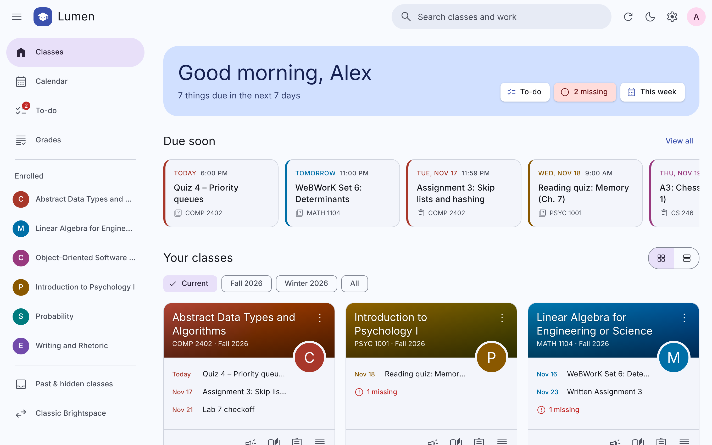
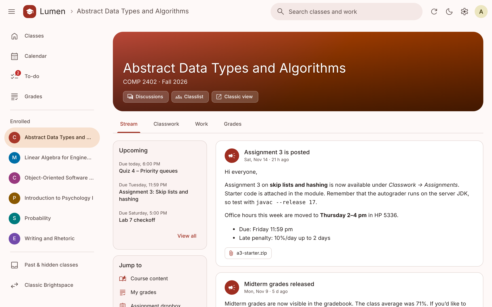
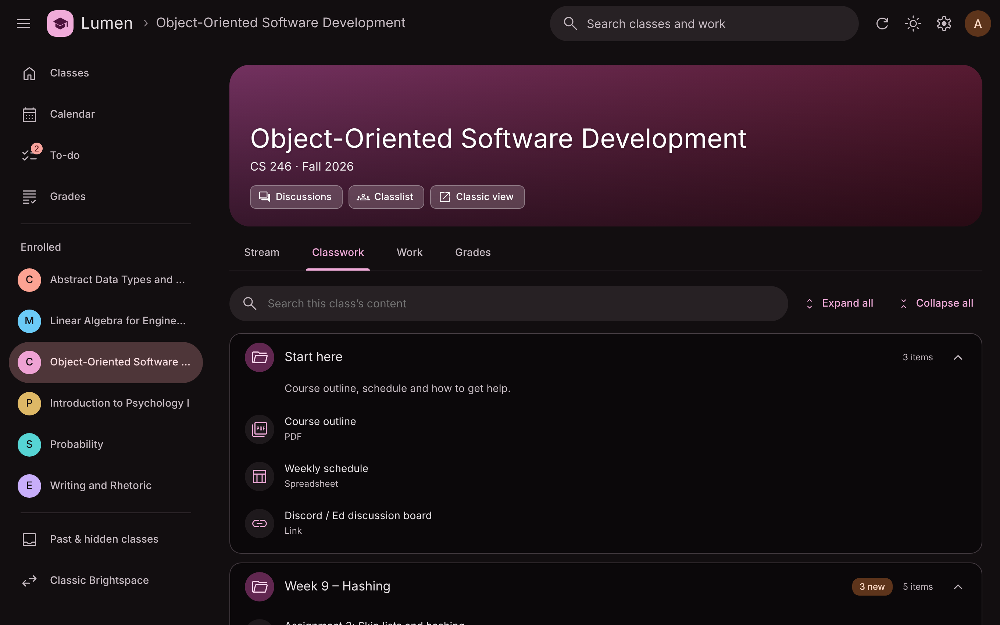
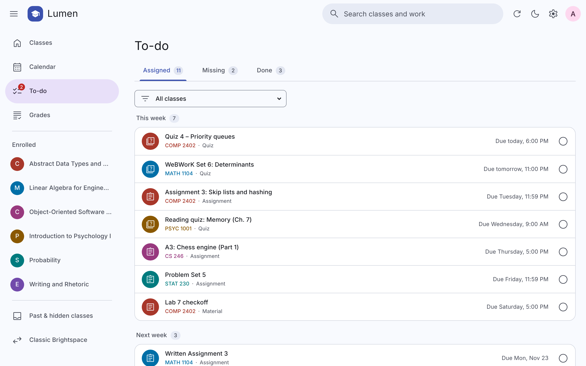

# Lumen for Brightspace

A browser extension that replaces the cluttered Brightspace (D2L) homepage with a clean, organized
interface inspired by **Material You** and **Google Classroom**. Works with:

- **Carleton University**: `brightspace.carleton.ca`
- **University of Waterloo (LEARN)**: `learn.uwaterloo.ca`
- Any school hosted at `*.brightspace.com`



| Class stream | Classwork (dark) | To-do |
|---|---|---|
|  |  |  |

**Three ways to use it:**
- **Browser extension.** Lumen replaces the Brightspace homepage itself. Install steps are below.
- **Website** (`web/`). Lumen on its own address: connect through the extension, sign in with Brightspace (OAuth),
  or try the demo. See [web/README.md](web/README.md).
- **Native apps** (`native/`). Fully native clients for iOS/macOS (SwiftUI), Android (Jetpack Compose) and
  Windows (WPF). You sign in on the official Brightspace page and the app reads the session cookie to load your
  classes — no extension, no server. See [native/README.md](native/README.md).

## What you get

| Screen | What it does |
|---|---|
| **Classes** | A greeting, a *Due soon* strip, and Classroom-style class cards with the next few due items on each. Filter by term (Current / Fall 2026 / …), switch between grid and list, hide old classes. |
| **Class → Stream** | Announcements as clean cards, with long posts collapsed, attachments as chips, and a sidebar with what's due in this class. |
| **Class → Classwork** | All course content as collapsible modules with type icons (PDF, slides, video, link, quiz…), *new* badges, and instant search across every file in the class. |
| **Class → Work** | Assignments and quizzes grouped as Missing / Upcoming / No due date / Done. |
| **Class → Grades** | Your current weighted grade as a progress ring, plus every grade item with a bar, its weight and instructor comments. |
| **To-do** | Everything assigned across all classes: *Assigned · Missing · Done*, bucketed into This week / Next week / Later. Tick items off yourself. |
| **Calendar** | A week view of everything due, color-coded by class. |
| **Grades** | One card per class with your current standing. |
| **Search** (`/`) | Jump to any class or piece of work from the top bar. |

Every class gets its own color, and inside a class the whole interface re-tints to that color, the way
Material You dynamic color works. Light and dark themes, 8 accent colors, and a compact density are in Settings.

## Install (Chrome, Edge, Brave, Arc)

1. Download this folder (`brightspace-wrapper/`).
2. Open `chrome://extensions` and turn on **Developer mode** (top right).
3. Click **Load unpacked** and select the `brightspace-wrapper` folder.
4. Go to your Brightspace homepage and sign in as usual. Lumen takes over the homepage.

## Using it alongside classic Brightspace

- Links to files, submissions and quizzes open the real Brightspace pages. Lumen organizes things; it doesn't reimplement submitting work.
- On any classic Brightspace page, a **Lumen** button sits in the bottom-right corner to bring you back.
- Add `?lumen=off` to the homepage URL (or use **Classic Brightspace** in the menu) to see the original page once.
- Settings → *Replace the Brightspace homepage* turns the takeover off. Lumen then opens only from the button.
- Settings → *Open Brightspace pages in a new tab* keeps Lumen open while you work.

## How it works and privacy

- Lumen is a content script that runs **only on your school's Brightspace site**. It stops the stock homepage
  before it loads and draws its own interface in its place (`src/boot.js`).
- Data comes from Brightspace's own REST API (Valence) on the same site, using the session you're already
  signed into. **There are no passwords, API keys, servers or analytics.** Nothing leaves your browser.
- It only **reads** data. It never submits, edits or deletes anything in Brightspace.
- Settings, hidden classes and items you tick off are stored in your browser's `localStorage` for that site.

Endpoints used: `users/whoami`, `enrollments/myenrollments`, `content/myItems` (due dates and completion),
`{ou}/news`, `{ou}/content/toc`, `{ou}/dropbox/folders`, `{ou}/quizzes`, `{ou}/grades/values/myGradeValues`, `{ou}/grades/final/values/myGradeValue`.
API versions are discovered automatically from `/d2l/api/versions/`.

## Adding another school

Add its Brightspace host to the three lists in `manifest.json` (`host_permissions` and both `content_scripts.matches`),
then reload the extension.

## Development

No build step is needed: plain JavaScript and CSS.

```
src/
  boot.js     content-script entry: takes over /d2l/home and mounts the app
  app.js      shell: data store, router, top app bar, navigation drawer, search
  views.js    Classes, Class (Stream/Classwork/Work/Grades), To-do, Calendar, Grades, Settings
  api.js      Brightspace Valence API client (read-only, cached)
  theme.js    Material You color roles generated from a seed hue (OKLCH)
  ui.js       DOM helpers, date formatting, HTML sanitizer, settings
  icons.js    Material Symbols Rounded (generated by scripts/build-icons.mjs)
  app.css     Material 3 styles
  fab.js/.css the "back to Lumen" button on classic pages
  bridge.js   extension service worker that lets the Lumen website read Brightspace (read-only, per-site consent)
  consent.*   the "Let this website use Lumen?" popup
web/
  index.html, web.js, web.css   the website: connect screen + the same app
  server.mjs  optional Node server: static files, Brightspace OAuth sign-in, read-only API proxy
demo/         the full app running against a fake Brightspace with sample data
```

**Try it without Brightspace:** from the repository root, run `python3 -m http.server 8765` and open
<http://localhost:8765/brightspace-wrapper/demo/>. The demo runs the real `api.js` against a mock
(`demo/mock-brightspace.js`), so it's also the easiest place to work on the UI.

## Notes

- Some schools restrict individual API routes. If one is blocked, Lumen falls back (for example, it builds the
  To-do list from assignments and quizzes if the *my items* feed is unavailable) or shows a retry message for that section.
- Not affiliated with D2L, Carleton University, the University of Waterloo or Google. Icons are
  [Material Symbols](https://fonts.google.com/icons) (Apache 2.0).
