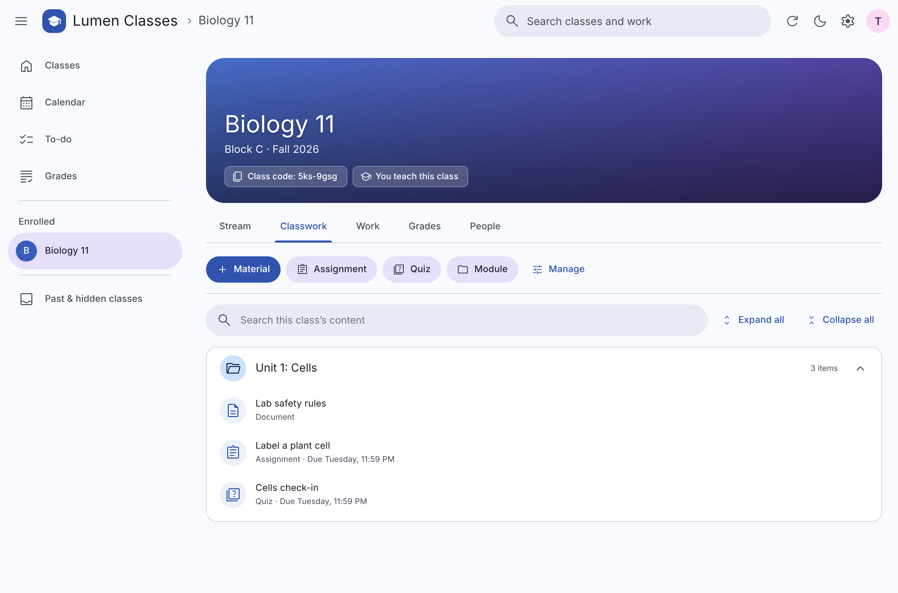
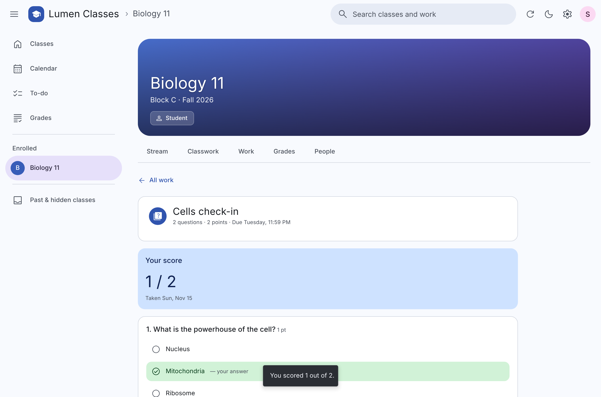

# Lumen Classes

A small, self-hosted learning platform — the part of Lumen that **replaces** Brightspace instead of
wrapping it. No dependencies: one Node server, one SQLite file.

```bash
cd brightspace-wrapper
npm run classes          # node classes/server.mjs → http://localhost:8200
```

Needs Node 22.5+ (it uses Node's built-in SQLite).

| Teacher: Classwork | Teacher: grading |
|---|---|
|  |  |
| **Teacher: gradebook** | **Student: quiz result** |
|  |  |

## What it does

**Anyone** can create an account. Whoever creates a class is its teacher; everyone who joins with the
class code is a student. One person can teach some classes and be a student in others.

| | Teachers | Students |
|---|---|---|
| **Classes** | Create a class, share its join code, remove students, archive | Join with a code, leave |
| **Stream** | Post and delete announcements | Read them |
| **Classwork** | Modules, notes, links, file uploads | Browse and search |
| **Assignments** | Title, instructions, due date, points | Hand in text and/or a file; change it until graded |
| **Grading** | See every hand-in, give a grade and feedback | See the grade and feedback |
| **Quizzes** | Multiple-choice questions with points | One attempt, marked instantly, answer key shown afterwards |
| **Grades** | Gradebook: students × items, overall % | Their own grades and overall % |
| **To-do / Calendar** | Upcoming deadlines for classes they teach | What's assigned, missing and done |

## How it's built

- `server.mjs` — the whole server: accounts, classes, authoring, hand-ins, grading, file storage.
- `public/classes.js` — everything that *writes* (sign-in, create/join, authoring, hand-ins, quizzes,
  grading). It plugs into the shared Lumen UI through `L.ext`.
- Reading reuses the **same Lumen UI as the Brightspace wrapper** (`../src`). The server exposes a
  read-only, Brightspace-shaped API (`/d2l/api/...`) next to its own (`/api/...`), so the Classes,
  Stream, Classwork, To-do, Calendar and Grades screens are the ones already built and tested.
- Because of that API (and a session cookie named like Brightspace's), the native apps in `../native`
  are designed to work against a Lumen Classes server too: choose *Another school* and enter its address.
  That path is by design and has not been run on a device yet.

Data lives in `classes/data/` (`lumen.db` + `files/`). Back up that folder; delete it to start over.

## Configuration

| Variable | Default | |
|---|---|---|
| `PORT` | `8200` | |
| `PUBLIC_URL` | `http://localhost:$PORT` | With `https://`, cookies are marked `Secure`. Put it behind HTTPS for real use. |
| `LUMEN_DATA` | `classes/data` | Where the database and uploads go |
| `LUMEN_ALLOW_SIGNUP` | `true` | Set `false` to stop new accounts |
| `LUMEN_MAX_UPLOAD_MB` | `25` | Per-file upload limit |

## Security

- Passwords are hashed with scrypt; sessions are random tokens stored hashed, in an `HttpOnly`,
  `SameSite=Lax` cookie. Login, sign-up and join attempts are rate-limited.
- Every write needs an `X-Lumen` header, which a cross-site form can't send (CSRF protection).
- Every route checks class membership; authoring and grading check for the teacher role. Students never
  see the join code, other students' emails, or each other's hand-ins.
- People type plain text; the server escapes it and only adds paragraphs and links, so no user HTML is
  ever stored or served. Uploaded files are served as downloads (PDFs and images inline) under a
  sandboxing CSP, so an uploaded HTML file can't run as the site.
- The quiz answer key is only sent to a student after they hand the quiz in.

## Tests

```bash
npm run test:classes                         # 12 API tests: flows + permission rules
node classes/server.mjs &                    # then, with Playwright installed and a fresh LUMEN_DATA:
node classes/e2e.cjs                         # full teacher + student story in a real browser
```

## Not there yet

Honest list of what a school would still want before dropping Brightspace: discussions, rubrics,
question types beyond multiple choice, quiz time limits and retakes, editing items after creating them
(today you delete and recreate), co-teachers, email notifications, password reset, single sign-on,
grade export, and an admin console. Sessions and rate limits are in-memory/SQLite, so run one instance.
