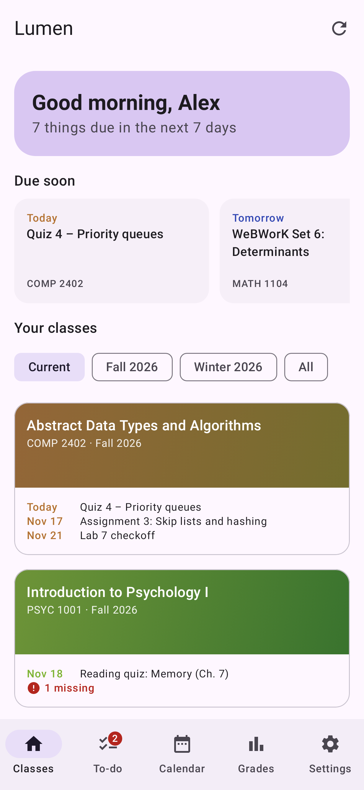
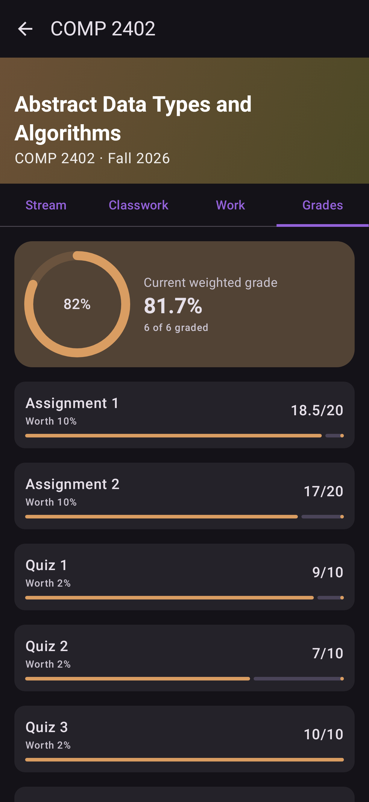

# Lumen native apps (iOS / macOS, Android, Windows)

Fully native Lumen clients. The UI is **native on every platform** — SwiftUI, Jetpack
Compose and WPF — not a web view wrapping the website. The **only** web view in each app is
the official Brightspace **sign-in page**, which can't be anything else (it's the school's
own SSO/MFA page).

## Why a native app, and why it can do what a website can't

- A website on `lumen.example.com` can't read `brightspace.carleton.ca`'s session cookie —
  it's `HttpOnly` and locked to the Brightspace origin, and cross-origin reads are blocked.
- A native app signs you in on the **official Brightspace page** inside a system web view,
  then reads the session cookie from **its own cookie store** and calls the Valence API with
  native HTTP (`URLSession` / `HttpURLConnection` / `HttpClient`). Native HTTP isn't bound by
  the browser's CORS rules, so this works.

Everything is **read-only**: Lumen only ever makes `GET` calls to `/d2l/api/…`. Your password
only goes to Brightspace's own page; nothing is sent to any Lumen server (there isn't one).

## Shared design (all three)

Each app has the same layers, written natively per platform:

| Layer | iOS/macOS (Swift) | Android (Kotlin) | Windows (C#) |
|---|---|---|---|
| Models | `Models.swift` | `Models.kt` | `Models.cs` |
| API client (read-only Valence) | `BrightspaceAPI.swift` | `BrightspaceApi.kt` | `Models.cs` (`BrightspaceApi`) |
| Dynamic course color | `Theme.swift` | `Theme.kt` | `Palette.cs` |
| State | `AppStore.swift` | `AppViewModel.kt` | `AppState.cs` |
| Login web view (only web view) | `LoginWebView` in `LumenApp.swift` | `LoginWebView` in `MainActivity.kt` | `LoginWindow.xaml.cs` |
| Screens | `ClassesView` / `CourseView` / `Screens.swift` | `Screens.kt` / `Screens2.kt` | `MainWindow` / `CourseWindow` |

Screens: **Classes** (hero, due-soon, course cards), **Class** (Stream / Classwork / Work /
Grades), **To-do**, **Calendar** (iOS/Android), **Grades**, **Settings**. Each course keeps a
stable color computed the same way as the web app, so a class looks the same everywhere.

## iOS & macOS (Swift / SwiftUI)

`native/ios/Lumen/` — pure SwiftUI; cookies via `WKHTTPCookieStore`, requests via `URLSession`.

1. Xcode → **File ▸ New ▸ Project ▸ App** (SwiftUI, name it Lumen), then add all `.swift`
   files from `native/ios/Lumen/` to the target (or point the project at this folder).
2. iOS 16+ / macOS 13+ (uses `NavigationStack`, `.task(id:)`). Build for iOS, or run as
   **Mac Catalyst** for macOS (same code).
3. No third-party dependencies.

## Android (Kotlin / Jetpack Compose)

`native/android/` — Compose Material 3; cookies via `CookieManager`, requests via
`HttpURLConnection` on coroutines. **This one is built and tested** (see below).

| | |
|---|---|
|  |  |

**Build** (JDK 17+ and the Android SDK with platform 34 / build-tools 34; set `ANDROID_HOME` or
`sdk.dir` in `native/android/local.properties`):

```bash
cd native/android
./gradlew assembleDebug        # → app/build/outputs/apk/debug/app-debug.apk
adb install -r app/build/outputs/apk/debug/app-debug.apk
```

Or just open `native/android/` in Android Studio. minSdk 26, targetSdk 34. The debug APK is signed
with the debug key; a Play Store build needs your own release signing config.

**Test** — the tests run the *real* client and the *real* Compose screens against a fake
Brightspace, so start that first:

```bash
node demo/mock-server.mjs            # fake Brightspace on http://127.0.0.1:8091
cd native/android && ./gradlew testDebugUnitTest
```

- `BrightspaceApiTest` (7): courses, work items + completion, announcements, content tree,
  weighted grades, signed-out detection.
- `ScreensRenderTest` (3): renders every screen headlessly (Robolectric native graphics) and
  writes screenshots to `app/build/screenshots/`.
- Both skip themselves if the mock isn't running — check the report says `skipped=0`.

**Try it on an emulator against the mock:** debug builds allow `http://`, so choose *Another
school* and enter `http://10.0.2.2:8091` (the emulator's name for your computer), then sign in
(the mock's login page sets the session cookie).

**How login works:** the only WebView is Brightspace's own sign-in. After each page on the
school's host finishes, the app calls `whoami`; sign-in is complete only when that succeeds, so it
doesn't depend on cookie names or when the school sets them.

## Windows (C# / WPF)

`native/windows/Lumen/` — native WPF; cookies via WebView2's `CookieManager` captured at
login, requests via `HttpClient`.

1. `dotnet run` (or open in Visual Studio 2022). Needs the WebView2 Runtime (preinstalled on
   current Windows 10/11); the only NuGet dependency is `Microsoft.Web.WebView2`.
2. Covers Classes, the class detail (Stream / Classwork / Work / Grades), To-do, Grades and
   Settings. It's the most compact of the three UIs.

## Status — built vs. compiled

| Platform | Compiled | Tested |
|---|---|---|
| **Android** | ✅ builds an APK | ✅ 10 tests: real API client + real screens against the mock |
| iOS / macOS | ❌ not compiled | — |
| Windows | ❌ not compiled | — |

iOS and Windows were written in a Linux environment, so expect a few small fixes on first build in
Xcode / Visual Studio. One known difference: their login screens still decide "signed in" by looking
for a cookie named `d2lSessionVal`, whereas Android verifies with a real `whoami` call. If a school
sets that cookie before login, those two would continue too early — porting Android's approach is
the fix.

## Privacy

- You sign in only on **Brightspace's own page** (SSO and MFA included). The app never sees or
  stores your password — only the resulting session cookie, on your device.
- All API calls are read-only `GET`s to `/d2l/api/…`. Lumen never writes to Brightspace.
- Hidden classes and items you tick off are stored locally on the device.
