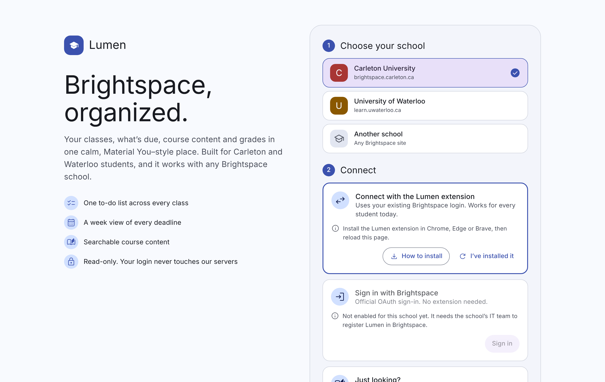

# Lumen website

The same Lumen interface as the extension, on its own website. A website can't read another
site's logged-in data, so students pick how Lumen connects to Brightspace:

| Mode | Works for | How it works |
|---|---|---|
| **Lumen extension** (recommended) | Every student, today | The website asks the installed extension to make **read-only** Brightspace API calls with the student's existing login (`src/bridge.js`). The student approves each website once in a popup. |
| **Sign in with Brightspace** | Schools that register Lumen | Official OAuth 2.0. `server.mjs` keeps the token server-side and forwards read-only `GET /d2l/api/...` calls. No extension is needed. |
| **Demo** | Anyone | Sample data, no account needed. |



## Run it

```bash
cd brightspace-wrapper
npm start            # node web/server.mjs → http://localhost:8080
```

Node 18+ is required, with no dependencies. Without OAuth settings, it serves the site with the extension and demo modes.

**Static hosting also works** (GitHub Pages, Netlify, etc.) for the extension and demo modes: publish the whole
`brightspace-wrapper/` folder and open `/web/`. Only OAuth sign-in needs `server.mjs`.

## Allow your website's address in the extension

The extension only accepts messages from addresses listed in `manifest.json` → `externally_connectable.matches`.
`localhost` and `127.0.0.1` are there for development. Add your deployed address, then reload the extension:

```json
"externally_connectable": { "matches": ["http://localhost/*", "http://127.0.0.1/*", "https://lumen.example.com/*"] }
```

The extension ID is fixed by the `key` in `manifest.json` (`olgakggjgkjippiinfgkjghidbfjaepp`), and
`web/web.js` uses it to find the extension.

## Enable "Sign in with Brightspace" (OAuth 2.0)

This needs the school's Brightspace administrators (Carleton or Waterloo IT) to register Lumen under
*Admin Tools → Manage Extensibility → OAuth 2.0 → Register an app*:

- **Redirect URI:** `https://<your-site>/auth/callback`
- **Scope:** read access to users, enrollments, content, news, dropbox, quizzes and grades (or `core:*:*`)

Then start the server with the credentials they give you:

```bash
PUBLIC_URL=https://lumen.example.com \
CARLETON_CLIENT_ID=... CARLETON_CLIENT_SECRET=... \
UWATERLOO_CLIENT_ID=... UWATERLOO_CLIENT_SECRET=... \
npm start
```

For any other school, use `LUMEN_SCHOOLS`:

```bash
LUMEN_SCHOOLS='[{"id":"myschool","name":"My School","host":"https://myschool.brightspace.com","clientId":"...","clientSecret":"..."}]'
```

| Variable | Default | |
|---|---|---|
| `PORT` | `8080` | |
| `PUBLIC_URL` | `http://localhost:$PORT` | Used for the OAuth redirect URI. With `https://`, cookies are marked `Secure`. |
| `D2L_SCOPE` | `core:*:*` | Space-separated scopes |
| `D2L_AUTH_URL` / `D2L_TOKEN_URL` | Brightspace's global auth service | Only change these for testing |

The sign-in button turns on automatically for each school with credentials (`/web/config.json` lists them).

## Security

- **Extension bridge:** only `GET`, only `/d2l/api/` paths, and only the Brightspace hosts the extension knows.
  Messages are accepted only from allowlisted addresses, and the student approves each address once.
- **Server:** OAuth `state` is checked, and tokens stay on the server. The browser only gets an `HttpOnly`, `SameSite=Lax`
  session cookie. The proxy is `GET`-only, limited to `/d2l/api/`, and `no-store`, so nothing is cached after sign-out.
  Static files come from an allowlisted set of folders, and a strict CSP is set.
- Sessions are kept in memory. To run more than one server instance, move them to a shared store.

## Note on the extension bridge and cookies

Chrome attaches Brightspace's login cookie to the extension's background requests only if the cookie is
`SameSite=None`. When it isn't, the bridge runs the request inside a Brightspace tab instead. If no Brightspace
tab is open, it opens a small pinned background tab once and reuses it.
